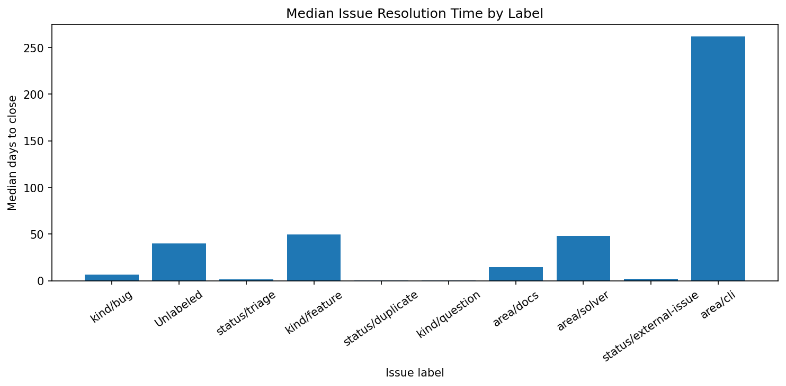

# Poetry GitHub Issue Analytics

**ENPM611 — Software Engineering Team Project**

This project extends the ENPM611 Python application template to analyze issue activity in the [Poetry](https://github.com/python-poetry/poetry) open-source repository. It uses a prepared JSON dataset of GitHub issues and timeline events to explore issue resolution, contributor activity, and issue priority and complexity.

## Project goals

The team is developing three complementary analyses:

| Feature | Analysis | Question addressed |
| --- | --- | --- |
| **1** | **Issue Resolution Time by Label** | Which issue categories take longer to close? |
| **2** | **Contributors Dashboard** | What insights can be gathered about contributor activity? |
| **3** | **Priority & Complexity Prediction** | How can issue priority and complexity be estimated? |

The analyses are intended to produce interpretable findings, not just raw counts. Feature 1 supports a user-supplied label and displays summary statistics and a matplotlib chart. Features 2 and 3 are team workstreams; verify their implementation and output before describing them as complete.

## Requirements

- Python 3.10 or newer (recommended)
- Dependencies listed in `requirements.txt`
- A local copy of the prepared `poetry_issues.json` dataset

The provided model uses `python-dateutil` to parse dates; the analysis charts use `matplotlib`. Install dependencies from the repository's requirements file and ensure those packages are included.

## Setup

1. Clone the **team's fork** and open the project folder:

   ```bash
   git clone <TEAM_REPOSITORY_URL>
   cd <REPOSITORY_FOLDER>
   ```

2. Create and activate a virtual environment.

   **Windows PowerShell:**

   ```powershell
   py -m venv .venv
   .\.venv\Scripts\Activate.ps1
   ```

   **macOS / Linux:**

   ```bash
   python3 -m venv .venv
   source .venv/bin/activate
   ```

3. Install project dependencies:

   ```bash
   python -m pip install -r requirements.txt
   ```

4. Place the prepared dataset in the repository root (or update the configuration to its actual path). Set `config.json` to:

   ```json
   {
     "ENPM611_PROJECT_DATA_PATH": "poetry_issues_all.json"
   }
   ```

   Only one dataset path is active at a time. To use `poetry_issues_all.json` instead, change the configuration value to that filename and ensure the file exists locally.

> **Data note:** The JSON dataset is provided for the course. Do not commit the large dataset to Git unless the template or instructor explicitly requires it.

## Run the analyses

Run all commands from the repository root with the virtual environment active.

### Feature 1 — Issue Resolution Time by Label

```bash
python run.py --feature 1 --label kind/bug
```

The optional `--label` argument selects a particular label. The dataset contains labels such as `kind/bug`; `bug` is not necessarily an equivalent label.

To display the top labels without selecting one:

```bash
python run.py --feature 1
```

**Method:** The analysis loads issue objects, identifies closed issues with usable dates, computes the elapsed time between `created_date` and the latest recorded `closed` event, groups results by label, and reports the count, mean, and median resolution time. A matplotlib bar chart compares median resolution times for the ten most frequent labels among the analyzed closed issues.

**Interpretation:** Median resolution time describes a typical closed issue, while the mean can be affected by unusually long-lived issues. Time to closure does not necessarily equal time to a confirmed fix. An issue with multiple labels can contribute to multiple label groups. Issues without usable closure timestamps are excluded.

Feature 1: Label Resolution Time Analysis — Sample Results
This feature analyzes how long GitHub issues take to resolve, grouped by issue labels. It calculates the average and median resolution times for closed issues.
How to Run
python run.py --feature 1 --label kind/bug
Sample Analysis Results
Metric	Result
Label	kind/bug
Number of closed issues	256
Median resolution time	0.91 days
Average resolution time	125.90 days

Interpretation:

The median resolution time of 0.91 days indicates that half of the analyzed closed bug issues were resolved within approximately 22 hours. The considerably higher average suggests that some issues remained open much longer, creating a right-skewed distribution.

Resolution Time Visualization

Figure 1: Comparison of median resolution times across GitHub issue labels.



Note: These results are from the previously analyzed dataset. 

### Feature 2 — Discussion Intensity vs. Resolution Time


```bash
python run.py --feature 2
```

**Planned purpose:** Explore whether issues with more discussion tend to have different resolution times. Confirm the exact metric, chart, and any supported arguments in the merged Feature 2 implementation.

### Feature 3 — Monthly Issue Activity Trends

```bash
python run.py --feature 3
```

**Planned purpose:** Summarize and visualize changes in GitHub issue activity over time. Confirm the exact metrics, chart, and any supported arguments in the merged Feature 3 implementation.

> Features 2 and 3 will run only after their implementations have been integrated into `run.py` and merged into the repository.

## Data model

The starter application reads JSON records and converts them into `Issue` and `Event` objects:

- `Issue.created_date`: issue creation timestamp
- `Issue.state`: open or closed status
- `Issue.labels`: list of label names
- `Issue.events`: timeline events, including `closed`, `labeled`, and `commented`
- `Event.event_date`: timestamp for the event
- `Event.event_type`: type of timeline event

For Feature 1, the closure timestamp comes from a `closed` event, **not** from `updated_date`. Updating an issue after closure does not change its resolution time.

## Project structure

```text
project-root/
├── run.py                         # CLI entry point and feature dispatch
├── config.py                      # Configuration reader
├── config.json                    # Active dataset path
├── data_loader.py                 # Loads JSON as Issue objects
├── model.py                       # Issue and Event models
├── example_analysis.py            # Starter example
├── issue_analysis_utils.py        # Shared analysis helpers
├── label_resolution_analysis.py   # Feature 1
├── requirements.txt               # Python dependencies
├── README.md
├── poetry_issues.json             # Local dataset; usually not committed
└── tests/
    └── test_label_resolution_analysis.py
└── images/
    └── label_resolution_chart.png    
```

Additional Feature 2/3 modules and tests should be added to this structure when merged. This tree shows the confirmed Feature 1 files, not a complete inventory of the team's final repository.

## Testing

Run the test suite from the project root:

```bash
python -m unittest discover -s tests -v
```

Then perform a manual end-to-end check:

```bash
python run.py --feature 1 --label kind/bug
```

Confirm that the command loads the configured JSON dataset, prints meaningful statistics, and displays the matplotlib chart. Unit tests using synthetic issue records do not by themselves verify compatibility with the actual Poetry JSON schema.

## Team collaboration

Development takes place in the team's fork of the starter repository. Each team member should work on a feature branch, commit meaningful changes, push the branch, open a pull request targeting `main`, and participate in review before merging.

Example workflow for Feature 1:

```bash
git checkout feature/label-resolution-analysis
git status
git add README.md run.py config.json issue_analysis_utils.py label_resolution_analysis.py tests/test_label_resolution_analysis.py
git commit -m "Document and implement label resolution analysis"
git push -u origin feature/label-resolution-analysis
```

Stage only files that exist and belong to your change. Do not commit `.venv/`, credentials, or large dataset files. If a pull request already exists for the branch, new pushed commits appear in that same pull request.

## ENPM611 milestones

1. **Design:** Component diagrams, sequence diagram, and repository URL.
2. **Implementation:** Three completed analyses and an updated README in the team repository.
3. **Testing:** Test another team's application, report failures and defects, and document coverage.
4. **Presentation:** Present the analyses, findings, design, testing results, and a live demonstration.

## Limitations

- Findings reflect the provided dataset, not necessarily all current GitHub issues.
- An issue can have multiple labels, so label-group counts should not be summed to estimate unique issues.
- Closed issues lacking a valid recorded closure event cannot be assigned a reliable resolution duration using this method.
- Correlation between discussion activity and resolution time does not establish causation.

## Team Contributions

| Feature | Contribution | Team Member |
|---|---|---|
| Feature 1 | Label Resolution Time Analysis | Bala Govindaraju |
| Feature 2 | Contributors Dashboard | Jael Andre |
| Feature 3 | Priority & Complexity Prediction | Bhargav Nallamothu |


## Feature 3: Priority & Complexity Prediction — Example Output and Use Cases

The following example illustrates the proposed JSON output format for the priority and complexity prediction feature. The values are illustrative and should be verified against the implemented feature before submission.

### JSON Output Format

```json
{
  "predicted_priority": "Medium",
  "priority_confidence": 89.0,
  "complexity_score": 75,
  "number": 9780,
  "title": "Issue title...",
  "url": "https://github.com/python-poetry/poetry/issues/9780",
  "labels": ["kind/bug", "status/triage"],
  "num_comments": 1
}
```

### Use Cases

1. **Triage Automation:** Quickly identify which issues need immediate attention.
2. **Resource Allocation:** Match developers to issues based on complexity.
3. **Sprint Planning:** Balance high-priority items with complexity estimates.
4. **Maintainer Insights:** Understand which types of issues are most urgent versus most complex.
5. **Trend Analysis:** Track how priority and complexity correlate over time.

*Note: These are intended use cases. The JSON structure, prediction confidence, and complexity score should be confirmed against Feature 3's actual implementation; they are not verified model results.*

## Project attribution

Developed as a three-member team project for **ENPM611**, using the course-provided application template and prepared GitHub issue data from the Poetry open-source project.
